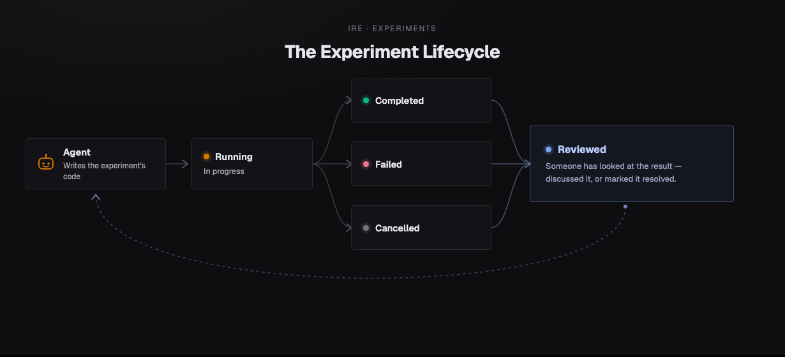

# The Experiment Lifecycle



## The problem

An experiment used to be "done" the moment its process exited. IRE would
immediately resume the chat that started it, whether or not anyone was
around, ready, or interested yet. You had no say in whether, when, or where
the result got discussed — it just happened, spending a turn on your behalf.

## The idea

**Finishing a process and finishing an experiment are two different things.**
A run is *complete* when it exits. It is *reviewed* when someone has actually
engaged with what it found — read it, discussed it, decided what to do next.
IRE now tracks both, as two steps of the same lifecycle instead of one event.

## The lifecycle

```
running → completed / failed / cancelled → reviewed
```

- **Running.** An agent started it; logs stream live.
- **Completed / Failed / Cancelled.** The process is over. This alone no
  longer triggers anything — it's a fact, not a notification.
- **Reviewed.** Someone has looked at the result: either by opening a chat
  about it (new or existing), or by explicitly marking it resolved without
  one — for when you already read the write-up directly.

A cancelled run can be reviewed too — cancelling isn't always the end of the
conversation; you might cancel one specifically to ask for a change and pick
it back up.
